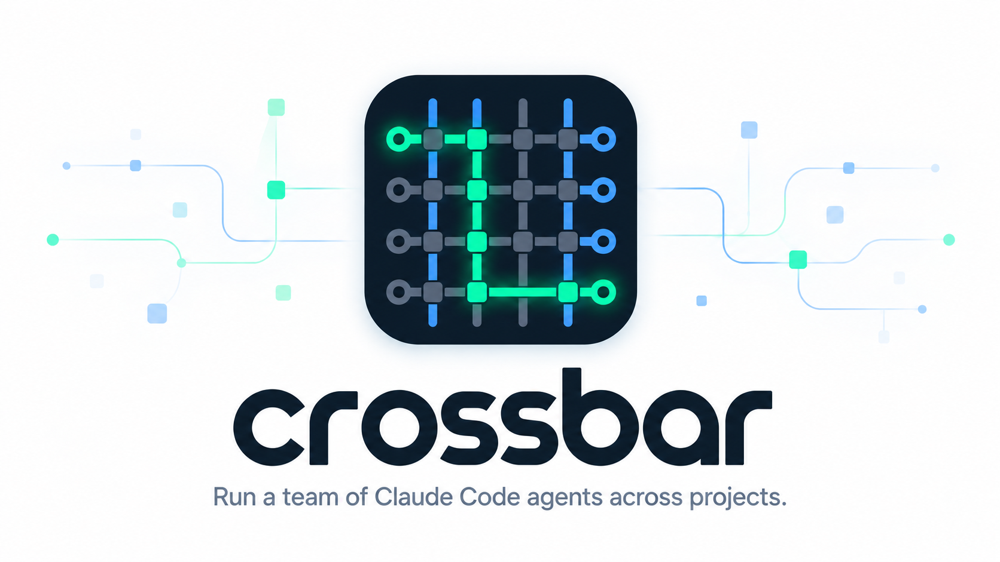

<picture>
  <source media="(prefers-color-scheme: dark)" srcset="assets/crossbar-hero-dark.png">
  <source media="(prefers-color-scheme: light)" srcset="assets/crossbar-hero-light.png">
  
</picture>

---

<p align="center">
  <a href="#summary">Summary</a> ·
  <a href="#install">Install</a> ·
  <a href="#usage">Usage</a> ·
  <a href="#switchboard">Switchboard</a> ·
  <a href="#multiplexers">Multiplexers</a> ·
  <a href="#development">Development</a>
</p>

---

## Summary

- **Exchange**: the top level, a set of projects you run together, such as `central` (default), `work` or `personal`.
    - **Supervisor**: a Claude in the exchange's session that coordinates across its projects.
    - **Exchange switchboard**: a live view of the whole exchange, next to the supervisor.
- **Project**: a folder or repo in an exchange, such as `central/stats`.
    - **Operator**: a Claude in the project's first tab that plans the work, hands tasks to agents, watches them and reports back.
    - **Project switchboard**: a live view of the project's agents, next to the operator.
- **Agent**: a Claude started in its own tab for one task, with a brief and a report file. Agents have no switchboard.

crossbar brings no conventions of its own. Operators and agents follow each project's
(its CLAUDE.md, AGENTS.md, CONTRIBUTING and history) and yours.

## Install

Requires [Claude Code](https://claude.com/claude-code) and Rex or tmux (3.0+), on macOS or
Linux. Any login shell works.

```sh
git clone https://github.com/montanaflynn/crossbar.git
cd crossbar && ./install
```

`./install` downloads `cbar`, `switchboard` and `claude-relay` for your platform from the
GitHub release (or builds them, if [cargo](https://rustup.rs) is installed), puts them in
`~/.crossbar/bin` next to the role prompts, and links them into `~/.local/bin`. To update:

```sh
cbar update     # install the latest main
cbar version
```

## Usage

Start your exchange, then add projects:

```sh
cbar up                      # the supervisor and exchange switchboard, plus every project's
                             # session, operator and project switchboard that isn't running
cbar new stats ~/code/stats  # a project: its session, an operator and a project switchboard
```

Then talk to the supervisor or an operator. They start agents and watch them with the same
commands you can use yourself.

### Paths

Everything has a path, `exchange/project/agent`, and its depth says what it is:

```
central               the exchange (its supervisor, in session `central`)
central/stats         a project (its operator, in session `central/stats`)
central/stats/fix-x   an agent (tab `fix-x` of session `central/stats`)
central/research      an agent of the exchange itself (tab `research` of session `central`)
```

Paths are relative to where you are: inside a project's session, `fix-x` is its agent; inside
an exchange's session, or outside crossbar (in the default exchange), `stats` is its project. A
name that isn't found nearby is looked up a level higher. `/work/stats` is absolute and `..`
goes up. `operator` and `supervisor` are reserved names, for the tabs a project and an exchange
run in. In `send`, `status`, `tail`, `wait` and `restart`, a project's path means its operator
and an exchange's means its supervisor.

### Commands

```
cbar new PROJECT [DIR] [--tmux|--rex]  register a project and start its session with an operator
                                       and a project switchboard (DIR: this folder; terminal: the
                                       one you're in, else Rex if it's running)
cbar new PROJECT/AGENT [BRIEF]         start Claude in a new tab of the project on its brief,
         [--no-worktree]               <project>/briefs/AGENT.md (BRIEF is copied there); in its
                                       own git worktree when the project is a git repo
cbar new --agent AGENT [BRIEF]         the same in the exchange's own session
cbar new --exchange NAME [DIR]         create an exchange and start its supervisor and exchange
                                       switchboard in DIR (see Files)
cbar up [EXCHANGE] [--tmux|--rex]      start the supervisor, the exchange switchboard and every
                                       project's session, operator and project switchboard that
                                       isn't running (a switchboard pane with only a shell
                                       counts); leaves whatever runs alone
cbar ls [PATH]                         exchanges > projects > agents, with their status
cbar open [-n] PATH                    switch to that session (an agent: its tab; outside tmux,
                                       attach; -n prints the command)
cbar send PATH TEXT                    type TEXT and Enter into its Claude, only if idle or done
cbar status PATH                       its Claude's state
cbar tail PATH [N]                     the last N lines of its screen
cbar wait PATH [SECONDS]               wait until it stops working
cbar restart PATH                      restart its Claude on today's role prompt, resuming its
                                       conversation (only if idle or done)
cbar rm [-y] [-f] PATH                 an agent: close its tab, and remove its worktree if clean
                                       and merged (refuses while it works, is blocked or has
                                       uncommitted changes, unless -f); a project or an exchange:
                                       kill its session and unregister it, briefs and reports too
                                       (asks first)
cbar watch [--next]                    a line each time one of your agents or operators turns
                                       done, blocked or error, stops or closes (--next: wait for
                                       the first event, print it and exit)
cbar board [EXCHANGE|PROJECT] [--all]  the switchboard (--once prints once, --json prints JSON)
cbar update | version | help
```

Operators hear about their agents from `cbar watch`, and supervisors about their own agents
and their projects' operators. When it starts, it also prints what is already blocked or in
error, anything done that a previous watch hadn't reported, and anything a previous watch knew
that has stopped or closed since. Supervisors and operators run `cbar watch --next` as a
background Bash command: it waits, silently, for the first event, prints it (and whatever else
happens within a second), and exits; they act on it and start it again. Run one after another,
the runs print every event once, and a blocked or errored report once printed isn't printed
again. What each watch knew is kept in `~/.crossbar/watch/<session>.json`.

The panes cbar makes run `cbar run supervisor|operator|board|agent` as their own command, so
nothing is typed into a shell. When that program exits, the pane drops to your login shell.

`cbar restart PATH` moves a running Claude onto the current crossbar, for example after
`cbar update` changed the role prompts. It finds the Claude session id in
`~/.claude/sessions/<pid>.json`, types `/exit` (or sends SIGTERM if that doesn't work), starts
`cbar run … --resume <id>` in the same pane, and once it's up tells it why it was restarted.
Restarting your own pane waits until your turn ends; its log is in `~/.crossbar/logs/`. On
`/exit`, cbar answers only two of Claude's questions: keep an agent's worktree, and stop
background work such as a `cbar watch --next`. It never answers the folder-trust question: if
the restarted Claude asks, cbar says so and exits 1, and you answer it in the pane.

### Files

```
~/.crossbar/
├── bin/                         cbar, switchboard, claude-relay: installed by ./install
├── operator.md, supervisor.md   the role prompts
├── config.toml                  default_exchange = "central"
├── version
└── exchanges/<exchange>/
    ├── exchange.toml            name, terminal, created, path
    ├── briefs/ reports/         the supervisor's agents
    └── projects/<project>/
        ├── project.toml         name, path, terminal, created
        └── briefs/ reports/     the operator's agents
```

An agent's brief is `briefs/<agent>.md` in its project's (or exchange's) folder, and it writes
its results to `reports/<agent>.md` next to it. The supervisor's session is named after its
exchange (`central`) and a project's is `<exchange>/<project>` (`central/stats`), so two
exchanges can each have a `stats`.

An exchange's supervisor and its own agents start in the `path` set in its `exchange.toml`
(`cbar new --exchange NAME DIR` sets it; `~/` works), else in the exchange's folder under
`~/.crossbar/exchanges/`. Never in `~`: Claude Code asks to trust the folder it starts in, and
never remembers that for your home folder.

## Switchboard

Switchboards show sessions, tabs and agents with their status: idle, working, done, blocked or
error.

- The **exchange switchboard**, next to the supervisor, shows the whole exchange: the exchange
  itself as card `0` and its projects as `1`-`9`. `a` switches to every exchange and back.
- A **project switchboard**, next to its operator, shows that project's tabs. Its `↖ central`
  link (named after the exchange), or `0`, jumps to the exchange switchboard.

Keys: `j`/`k` or the arrows select, tab moves to the next card, enter jumps, a number opens a
card, `q` quits. The mouse works too: click a row or a card's header to jump.

A switchboard that exits says why in its pane and in `~/.crossbar/logs/switchboard.log`, and
`cbar up` starts any that are missing.

## Multiplexers

crossbar runs in Rex or tmux. Each exchange and project lives in one of them, recorded in its
toml file. Switchboards show Rex and tmux sessions together and can jump to any pane: in Rex
they ask the Rex app, in tmux they switch the tmux client.

Claude Code reports its own status (its state, what it's blocked on, and a one-line summary) to
terminals that answer its OSC 7501 probe. Rex does. tmux doesn't, and the answer has to arrive
in the byte stream, so nothing outside the terminal can give it. So in tmux, cbar starts Claude
through `claude-relay`, a small proxy that answers the probe and writes the status to the pane's
tmux options, where the switchboard reads it. tmux then shows the same states and messages as
Rex.

`claude-relay` takes Claude's arguments and runs it on a pty of its own; outside tmux it just
runs `claude`. Ctrl-Z, resizing and exit codes work as usual. To get full status for a Claude
you start yourself in tmux, run `claude-relay` in its place (or `alias claude=claude-relay`).
Without it, tmux shows idle, working or blocked from `claude agents`, with no message.

To try tmux, from any terminal:

```sh
cbar new myproject ~/code/myproject --tmux
cbar open myproject          # attaches; inside tmux, switches to it
```

## Development

crossbar is a cargo workspace: `crossbar/` (`cbar` and `switchboard`) and `claude-relay/`.
Edit this repo, then run `./install --build` to try your changes with binaries built from your
checkout. Installing replaces `bin/` and the role prompts in `~/.crossbar`, so make changes
here, not in the installed copy. It never touches `config.toml` or `exchanges/`. Files are
swapped in by rename, so panes already running the old copy keep working.

`cargo test` runs the unit tests and the sandbox tests in `crossbar/tests/sandbox/`, which
drive `cbar restart`, the switchboards with `cbar up`, and `cbar watch` end to end. Each test
gets its own sandbox under `/tmp`: a private tmux server (`tmux -L`), a scratch `HOME` and
`CROSSBAR_HOME`, and a stub `claude` (`crossbar/tests/sandbox/stub/claude`) that reports the
states its brief asks for. The tests never touch your tmux server, Rex or `~/.crossbar`. They
need tmux and git, and are skipped without tmux. CI runs them on Linux and macOS on each push
to `main` and on pull requests.

The same tests on a private Rex server (`rex -S SOCK --autostart=false`) need Rex, so they only
run when you ask for them. They take turns, so they take a few minutes:

```sh
cargo test --test sandbox -- --ignored
```

Add `--nocapture` to see a line per check as it runs. `CBAR_TEST_VERBOSE=1` adds each check's
detail, and `CBAR_TEST_KEEP=1` keeps the sandbox so you can look at it afterwards.

Pushing a tag `vX.Y.Z` that matches `VERSION` builds the release binaries for macOS and Linux
(arm64 and x86_64) in GitHub Actions.

## License

MIT
