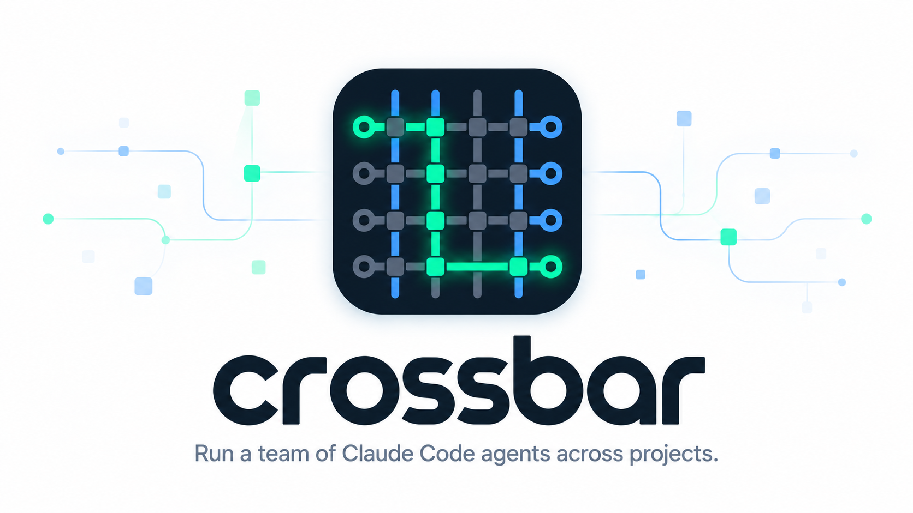

<picture>
  <source media="(prefers-color-scheme: dark)" srcset="assets/crossbar-hero-dark.png">
  <source media="(prefers-color-scheme: light)" srcset="assets/crossbar-hero-light.png">
  
</picture>

- **Exchanges**: sets of projects you run together, such as `central`, `work` and `personal`.
  Each has its own supervisor, main switchboard, briefs and reports.
- **Supervisor**: a Claude in the exchange's session (`central`) that coordinates across its
  projects.
- **Operators**: one per project. Each operator is a Claude in tab 1 (`operator`) of the
  project's session (`central/stats`). It plans the work, hands tasks to agents in other tabs,
  watches them and reports back.
- **Agents**: Claudes that an operator or the supervisor starts in other tabs,
  each with a brief and a report file.
- **Switchboard**: a live TUI of an exchange's sessions, tabs and agents with their status
  (idle, working, done, blocked, error). Click or press enter on a pane to jump to it. Each
  project gets a local switchboard next to its operator.

crossbar brings no conventions of its own. Operators and agents follow each project's
(its CLAUDE.md, AGENTS.md, CONTRIBUTING and history) and yours.

## Install

Requires [Claude Code](https://claude.com/claude-code) and Rex or tmux (3.0+), on macOS or
Linux. Any login shell works.

```sh
git clone https://github.com/montanaflynn/crossbar.git
cd crossbar && ./install
```

`./install` downloads `cbar`, `switchboard` and `claude-relay` for your platform from the
GitHub release (or builds them, if [cargo](https://rustup.rs) is installed), puts them in
`~/.crossbar/bin` next to the role prompts, and links them into `~/.local/bin`. Update later
with:

```sh
cbar update     # install the latest main
cbar version
```

## Use

Start an exchange and its projects:

```sh
cbar up                      # the exchange's supervisor and main switchboard, and every
                             # project's session and operator that isn't running
cbar new stats ~/code/stats  # a project: its session, an operator and a local switchboard
```

Then talk to the supervisor or an operator. They start agents and watch them with the same
commands you can use yourself.

### Paths

Everything is a path, `exchange/project/agent`, and its depth says what it is:

```
central               the exchange (its supervisor, in session `central`)
central/stats         a project (its operator, in session `central/stats`)
central/stats/fix-x   an agent (tab `fix-x` of session `central/stats`)
central/research      an agent of the exchange itself (tab `research` of session `central`)
```

Paths are relative to where you are. Inside a project's session, `fix-x` is its agent; inside
an exchange's session, or outside crossbar (in the default exchange), `stats` is its project.
A name that isn't found nearby is looked up a level higher. `/work/stats` is absolute and `..`
goes up. `operator` and `supervisor` are reserved: they're the tabs a project and an exchange
run in.

### Commands

```
cbar new PROJECT [DIR] [--tmux|--rex]  register a project and start its session with an operator
                                       and a local switchboard (DIR: this folder; terminal: the
                                       one you're in, else Rex if it's running)
cbar new PROJECT/AGENT [BRIEF]         start Claude in a new tab of the project on its brief,
         [--no-worktree]               <project>/briefs/AGENT.md (BRIEF is copied there); in its
                                       own git worktree when the project is a git repo
cbar new --agent AGENT [BRIEF]         the same in the exchange's own session
cbar new --exchange NAME               create an exchange and start its supervisor and main board
cbar up [EXCHANGE] [--tmux|--rex]      start the supervisor, the main switchboard and every
                                       project's session and operator that isn't running; leaves
                                       whatever runs alone
cbar ls [PATH]                         exchanges > projects > agents, with their status
cbar open [-n] PATH                    switch to that session (an agent: its tab; outside tmux,
                                       attach; -n prints the command)
cbar send PATH TEXT                    type TEXT and Enter into its Claude, only if idle or done
cbar status PATH                       its Claude's state
cbar tail PATH [N]                     the last N lines of its screen
cbar wait PATH [SECONDS]               wait until it stops working
cbar rm [-y] [-f] PATH                 an agent: close its tab, and remove its worktree if clean
                                       and merged (refuses while it works, is blocked or has
                                       uncommitted changes, unless -f); a project or an exchange:
                                       kill its session and unregister it, briefs and reports too
                                       (asks first)
cbar watch                             a line each time one of your reports turns done, blocked
                                       or error, stops or closes (operators: their agents;
                                       supervisors: their agents and their projects' operators)
cbar board [EXCHANGE|PROJECT] [--all]  the switchboard (--once prints once, --json prints JSON)
cbar update | version | help
```

In `send`, `status`, `tail` and `wait`, a project's path means its operator and an exchange's
its supervisor. `cbar watch` is meant for the Monitor tool: when it starts, it also prints what
is already blocked or in error, and anything done that a previous watch hadn't reported.

The panes cbar makes run `cbar run supervisor|operator|board|agent` as their own command, so
nothing is typed into a shell. When that program exits, the pane drops to your login shell.

The 0.4 forms still work and print a note: `cbar operator` and `cbar supervisor` (now
`cbar run …`), `cbar board --here` (`cbar run board`), and
`cbar agent new|ls|status|tail|send|wait|close` (`cbar new`, `ls .`, `status`, `tail`, `send`,
`wait`, `rm`).

### The switchboard

The main board, next to the supervisor, shows the sessions of its exchange: the exchange's own
as card `0`, its projects as `1`-`9`. `a` switches to every exchange and back. A project's local
board shows that session's tabs; its `↖ central` link (named after the exchange), or `0`, jumps
to the exchange's main board.
Keys: `j`/`k` or the arrows select, tab moves to the next card, enter jumps, a number opens a
card, `q` quits. The mouse works too: click a row or a card's header to jump.

### Rex and tmux

Each exchange and project lives in one terminal, recorded in its toml file. A switchboard
shows Rex and tmux sessions together, wherever they run, and jumps to any pane: in Rex it
asks the Rex app, in tmux it switches the tmux client.

Claude Code reports its own status (state, what it's blocked on, and a one-line
summary) to terminals that answer its OSC 7501 probe. Rex does; tmux doesn't, and the
answer has to arrive in the byte stream, so nothing outside it can give one. So in
tmux, `cbar` starts Claude through `claude-relay`, a small proxy that answers the
probe and writes the status to the pane's tmux options, where the switchboard reads it.
tmux then shows the same states and messages as Rex.

`claude-relay` takes Claude's arguments and runs it on a pty of its own; outside tmux
it just runs `claude`. Ctrl-Z, resizing and exit codes work as usual. To get full status
for a Claude you start yourself in tmux, run `claude-relay` in its place (or
`alias claude=claude-relay`). Without it, tmux shows idle, working or blocked from
`claude agents`, with no message.

To try tmux, from any terminal:

```sh
cbar new myproject ~/code/myproject --tmux
cbar open myproject          # attaches; inside tmux, switches to it
```

## Layout

```
~/.crossbar/
├── bin/                         cbar, switchboard, claude-relay: installed by ./install
│                                (don't edit, see below)
├── operator.md, supervisor.md   the role prompts
├── config.toml                  default_exchange = "central"
├── version
└── exchanges/<exchange>/
    ├── exchange.toml            name, terminal, created
    ├── briefs/ reports/         the supervisor's agents
    └── projects/<project>/
        ├── project.toml         name, path, terminal, created
        └── briefs/ reports/     the operator's agents
```

An agent's brief is `briefs/<agent>.md` in its project's (or exchange's) folder, and it writes
its results to `reports/<agent>.md` next to it. The supervisor's session is named after the
exchange (`central`), and a project's is `<exchange>/<project>` (`central/stats`), so two
exchanges can each have a `stats`.

## Develop

crossbar is a cargo workspace: `crossbar/` (`cbar` and `switchboard`) and `claude-relay/`.
Edit this repo, then run `./install --build` to try your changes with binaries built from your
checkout. Installing replaces `bin/` and the role prompts in `~/.crossbar`, so make changes
here, not in the installed copy. It never touches `config.toml` or `exchanges/`. Files are
swapped in by rename, so panes already running the old copy keep working. Pushing a tag
`vX.Y.Z` that matches `VERSION` builds the release binaries for macOS and Linux (arm64 and
x86_64) in GitHub Actions.

## License

MIT
